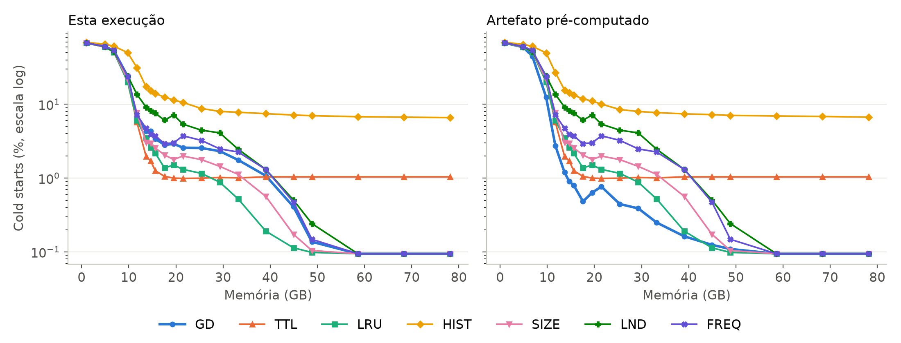
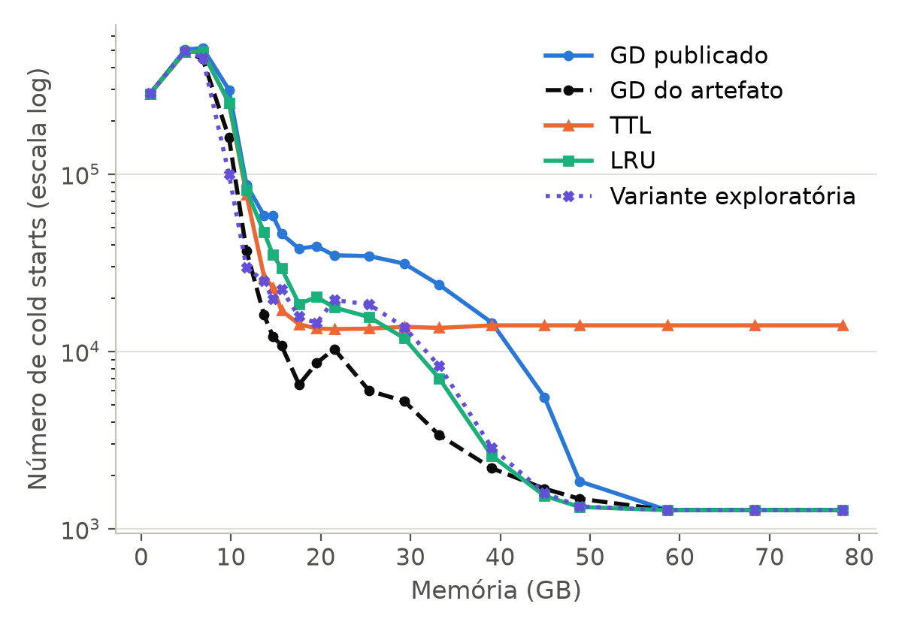
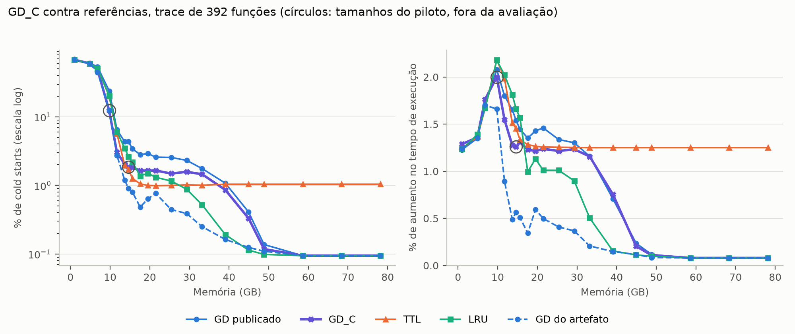

# Reprodução e evolução do FaasCache

Reprodução por simulação de [FaasCache: Keeping Serverless Computing Alive with Greedy-Dual Caching](https://doi.org/10.1145/3445814.3446757) (Fuerst e Sharma, ASPLOS '21) e avaliação de uma variação da política Greedy-Dual, chamada GD_C. Projeto da disciplina Provisionamento e Operação de Infraestruturas (PPGCC/UFCG, 2026.2).

O FaasCache trata o *keep-alive* de funções serverless como cache: manter um contêiner ocioso em memória equivale a manter um objeto em cache, e encerrá-lo equivale a removê-lo. A política Greedy-Dual (GD) dá a cada contêiner a prioridade `Clock + Frequência × Custo / Tamanho`. O artigo relata que GD reduz o aumento no tempo de execução causado por *cold starts* em mais de 3 vezes em relação a uma política de TTL fixo.

## Resultados

Todas as simulações usam o simulador e o trace de 392 funções (1.348.162 invocações) publicados pelos autores, em 20 tamanhos de memória entre 1 e 80 GB. Cada resultado foi comparado, função a função, com os resultados pré-computados do artefato.

| Política | Tamanhos idênticos ao artefato (de 20) | Observação |
|---|---|---|
| TTL, LRU, FREQ, SIZE | 20 | Código publicado. |
| LND | 20 | Só com custo `run_time - warm_time`; o código publicado usa `warm_time`. |
| GD | 3 | Só de 60 a 80 GB. De 1 a 50 GB, gera de 1,0 a 7,0 vezes os cold starts do artefato. |
| HIST | 0 | Fica entre -2,3% e +14,5% do artefato em cold starts. |

**GD não foi reproduzida.** O código publicado só atinge a redução de 3 vezes em relação a TTL a partir de 46 GB, contra 15 GB no artigo. Nenhuma das 24 variantes de fórmula testadas a 15 GB chegou aos 12.170 cold starts do artefato. No caso de HIST, 14 hipóteses de implementação foram testadas, uma de cada vez, e nenhuma explicou a diferença.





**GD_C** usa a frequência média entre as cópias de uma função, em vez da soma, para que cópias ociosas não elevem a prioridade da função. A política foi escolhida entre três candidatas num piloto a 10 e 15 GB e avaliada, sem ajuste, nos outros 18 tamanhos. Os critérios foram registrados antes da avaliação, em [`avaliacao_gd_c.md`](experimentos/avaliacao_gd_c.md).

| GD_C contra | Cold starts (vitórias / empates / derrotas) | Aumento no tempo de execução |
|---|---|---|
| GD publicado | 15 / 3 / 0 | 11 / 3 / 4 |
| TTL | 9 / 0 / 9 | 16 / 0 / 2 |
| LRU | 4 / 3 / 11 | 4 / 3 / 11 |
| GD do artefato | 1 / 3 / 14 | 0 / 3 / 15 |



Esses números vêm de um único trace e de um simulador determinístico. As contagens de vitórias descrevem esta grade de 18 tamanhos e não valem como teste estatístico.

## Estrutura

```
experimentos/
  reproducao.py, rodar.sh              # sete políticas em 20 tamanhos
  hist_variantes.py, rodar_hist.sh     # hipóteses para a divergência de HIST
  piloto_politicas.py, rodar_gd_c.sh   # piloto e avaliação de GD_C
  smoke_test.py, smoke_test.sh         # teste rápido (TTL e LRU a 1 GB)
  analisar.py, analisar_gd_c.py        # tabelas e figuras
  avaliacao_gd_c.md                    # critérios da avaliação de GD_C
  resultados*/                         # um JSON por simulação (política, memória)
  analise/                             # CSV, resumo e figuras
  diagnostico/                         # logs das rodadas de diagnóstico
  Dockerfile                           # Python 3.8 com numpy, pandas, scipy e matplotlib
```

## Como reproduzir

Requisitos: Docker e cerca de 16 GB de RAM livres para a rodada completa.

1. Baixe o artefato dos autores no Zenodo ([10.5281/zenodo.4321766](https://doi.org/10.5281/zenodo.4321766), arquivo `FaasCacheData.zip`) e coloque em `experimentos/artefato/`:
   - `split/`: simulador, com `LambdaScheduler.py`;
   - `392-b.pckl`: trace de 392 funções;
   - `392-pckls/`: resultados pré-computados, usados na comparação.

   O artefato não está neste repositório porque é de terceiros.

2. Construa a imagem:
   ```bash
   docker build -t faascache-smoke experimentos
   ```

3. Rode o teste rápido. Ele simula TTL e LRU a 1 GB, leva cerca de 1 a 2 minutos e não altera `resultados/`:
   ```bash
   experimentos/smoke_test.sh
   ```
   A última linha deve ser `SMOKE TEST OK`. Isso confirma que imagem, artefato e trace estão corretos: as duas políticas coincidem função a função com o artefato e com os resultados gravados aqui.

4. Rode as simulações completas. Cada script grava um JSON por simulação e pula os já gravados, então a rodada pode ser retomada. Para refazer do zero, apague os JSON da pasta correspondente.
   ```bash
   experimentos/rodar.sh       # E1 e E2: sete políticas, 20 tamanhos
   experimentos/rodar_gd_c.sh  # E4: GD_C nos 18 tamanhos da avaliação
   ```
   Cada simulação leva de cerca de 1,5 a 96 minutos, conforme a política e a memória. A rodada completa somou 73,7 horas de simulação, com até 10 em paralelo, numa máquina de 12 núcleos e 31 GB de RAM.

**Segurança:** os arquivos `.pckl` executam código ao serem carregados. Os scripts rodam o simulador em contêiner sem rede, sem capabilities e com o artefato montado só para leitura. Mantenha essas opções.

## Licença

Código deste repositório sob licença MIT. O simulador e o trace pertencem aos autores do FaasCache e seguem a licença do artefato original.
